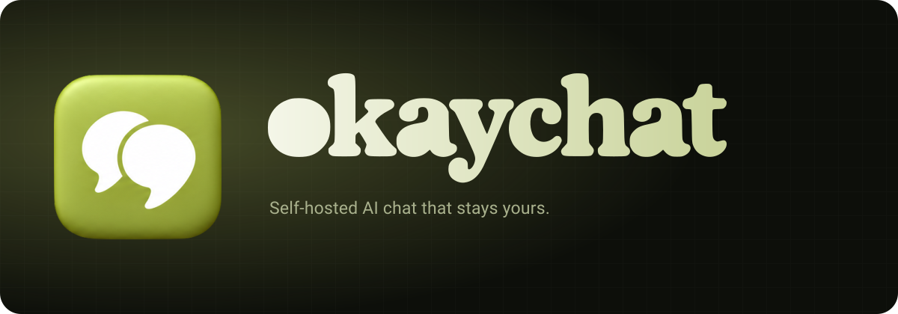

<p align="center">
  
</p>

<p align="center">
  <b>A fast, private, multi-user AI chat server with every provider, real tools, and a UI that feels finished.</b><br>
  Bring your own keys. Keep your conversations, files, and memory on your own machine.
</p>

<p align="center">
  <a href="#quick-start"></a>
  <a href="https://nodejs.org"></a>
  <a href="docs/implementation/security.md"></a>
  <a href="docs/ROADMAP.md"></a>
</p>

---

## Why okaychat

- **Every model, one place.** OpenCode Go, your own ChatGPT plan, OpenCode Zen, a local Ollama, and any OpenAI-compatible, Anthropic, or Google endpoint. Per-chat model and reasoning controls, live context and cost metering, prompt caching, and automatic compaction.
- **Tools that actually work.** MCP servers, web search, a real offline code sandbox, document editing, image generation, knowledge bases, memory, deep research, scheduled prompts, and voice — not a chat box with a prompt.
- **Built for several people.** Shared channels, accounts, groups, per-audience shared keys, per-model and per-user system prompts, granular feature and limit policies, storage quotas, and admin controls that do not require editing a config file.
- **Private by default.** SQLite plus files on your disk. Credentials and memory are encrypted at rest. Outbound requests to user-chosen URLs are DNS-checked, every hop. Chromium runs in its own container, away from app data.
- **Fast where it counts.** Streaming, reload recovery, a virtualized sidebar, a windowed message list, lazy routes, cached thread history, and a production bundle split so sign-in does not download the app.

## Quick start

Linux amd64 with Docker Compose is the tested platform. The browser worker and sandbox verify their isolation requirements at startup.

```sh
git clone https://github.com/selfxplanatorium/okaychat.git
cd okaychat
cp .env.example .env
```

Generate two independent secrets and put them in `.env`:

```sh
openssl rand -base64 32   # OKAYCHAT_SECRET
openssl rand -base64 32   # OKAYCHAT_SANDBOX_TOKEN
```

```sh
docker compose up -d --build
```

Open <http://localhost:8787>. The first account becomes the administrator. Connect OpenCode Go during onboarding, or pick a provider under **Settings → Providers**.

| Service | What it does |
| --- | --- |
| `okaychat` | App, API, SQLite, and uploads. Data lives in the `okaychat-data` volume. |
| `searxng` | Private web search, no public port. |
| `sandbox` | Python/Bash and document tools. Every run gets its own filesystem and network namespaces with no network. |
| `browser` | Chromium rendering and page fetching. Separate users and an egress firewall keep untrusted pages away from secrets. |

Back up the data volume and keep `OKAYCHAT_SECRET` separately. Losing the secret makes encrypted credentials and memory unreadable. [Storage accounting](docs/implementation/storage-quota.md) explains quotas; [security](docs/implementation/security.md) explains the boundaries.

The ChatGPT plan uses the official **Sign in with ChatGPT** flow for chat. Set `OKAYCHAT_PUBLIC_URL` to the deployment's canonical HTTPS origin and `OKAYCHAT_CHATGPT_OAUTH_ENABLED=true` after the release checks in [the ChatGPT guide](docs/implementation/codex-chat.md) pass. Image generation keeps its separate Codex CLI connection.

## A tour

<table>
<tr><td width="50%" valign="top">

**Chat**
- Streaming Markdown, math, Mermaid, syntax highlighting, and reasoning logs
- Branches, editable replies, retries, model switching, and full-text search
- Named assistants, a saved prompt library with variables and `/shortcuts`, bookmarks, feedback, and explicit continuation of truncated replies
- Shared team channels with rooms, mentions, reactions, realtime updates, and explicit AI replies
- Tags, saved filters, notifications, and portable chat archives
- Attachments: images, PDFs, DOCX, and text/code files
- Prompt-injection envelopes, approval gates, and honest errors
- Markdown/PDF export and share links with expiry, passwords, and frozen snapshots

**Models**
- OpenCode Go, ChatGPT plan, OpenCode Zen, Ollama, and 100+ providers
- Custom OpenAI-compatible endpoints and side-by-side model comparison
- Assistant presets with sampling, tool, and knowledge policies
- Private evaluation datasets, repeatable runs, manual or model-graded scoring, and CSV/JSON export
- Per-model reasoning effort and context/cost metering
- Shared keys with per-audience model policies and granular feature limits

</td><td width="50%" valign="top">

**Tools**
- MCP tools, resources, prompts, OAuth, forms, and embedded apps
- n8n webhook agents for your own workflows
- Keyless web search and readable page fetching
- Code execution in an offline sandbox
- PDF, Word, and Excel creation and in-place editing
- Artifacts, interactive widgets, and screenshots for vision models

**Knowledge & memory**
- Collections with hybrid lexical + vector retrieval and citations
- Opt-in encrypted memory with review, edit, and import/export
- Projects with instructions and pinned files
- Skills (Agent Skills) and deep research with cited reports

</td></tr>
</table>

**More:** scheduled prompts, voice calls, read-aloud and dictation, image generation, email drafting and sending, a persistent file library, keyboard-first controls, an installable PWA, and a theme engine with light/dark/system modes plus liquid-glass surfaces.

## Development

Node 22.13 or newer.

```sh
npm ci
cp .env.example .env
npx playwright-core install chromium
npm run dev
```

The server listens on `127.0.0.1:8787`, Vite on `127.0.0.1:5173`, and the local browser worker on `127.0.0.1:8791`. The dev command configures Tailscale Serve so the UI is available over HTTPS on port 5173; Tailscale must be running with Serve/HTTPS enabled.

Web search and code execution use sidecars in development. `.env.example` lists the variables, and [AGENTS.md](AGENTS.md#commands) has the exact commands.

```sh
npm run typecheck   # both TypeScript projects
npm test            # node test runner
npm run build       # web bundle + server
npm start           # serve the production build
```

## Architecture

| Layer | Choice |
| --- | --- |
| Server | Hono on Node, Web-standard `Request`/`Response` |
| LLM | AI SDK v7 with native Ollama transport and per-provider wire formats |
| Data | SQLite via `node:sqlite`; one file, one volume |
| Web | Vite + React 19 + Tailwind v4 + assistant-ui |
| Workers | Separate `browser`, `sandbox`, and `speech` containers |

The long-form implementation guides live in [`docs/implementation/`](docs/implementation/). Start with [chat runtime](docs/implementation/assistant-ui.md), [security](docs/implementation/security.md), and [prompt caching](docs/implementation/prompt-caching.md).

## Security

- Secrets are encrypted with `OKAYCHAT_SECRET` (AES-256-GCM).
- `publicFetch` pins public DNS and revalidates every redirect for user- and model-chosen URLs.
- Chromium, code execution, and speech run outside the app container.
- Model-written HTML runs in a null-origin frame with a restrictive CSP.
- Every response gets clickjacking, MIME, and referrer protections; writes are CSRF-guarded.

Read the full [threat model and residual risks](docs/implementation/security.md) before exposing an instance to the internet.

## Credits

The appearance system is ported from [T3 Code](https://github.com/pingdotgg/t3code) (MIT). The chat UI is built on [assistant-ui](https://www.assistant-ui.com). Bundled fonts and their licenses are listed in the [font guide](docs/implementation/bundled-fonts.md).
